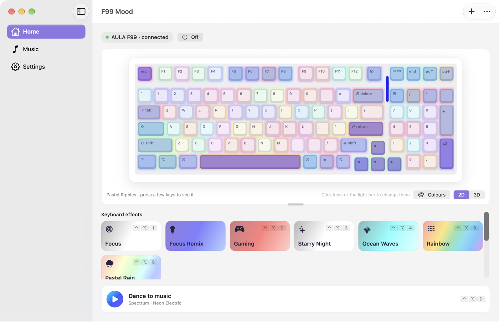
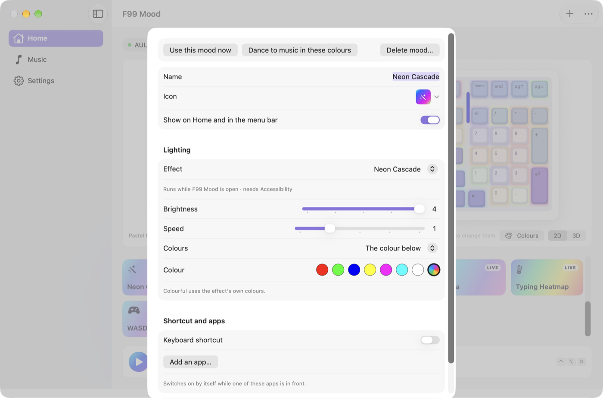
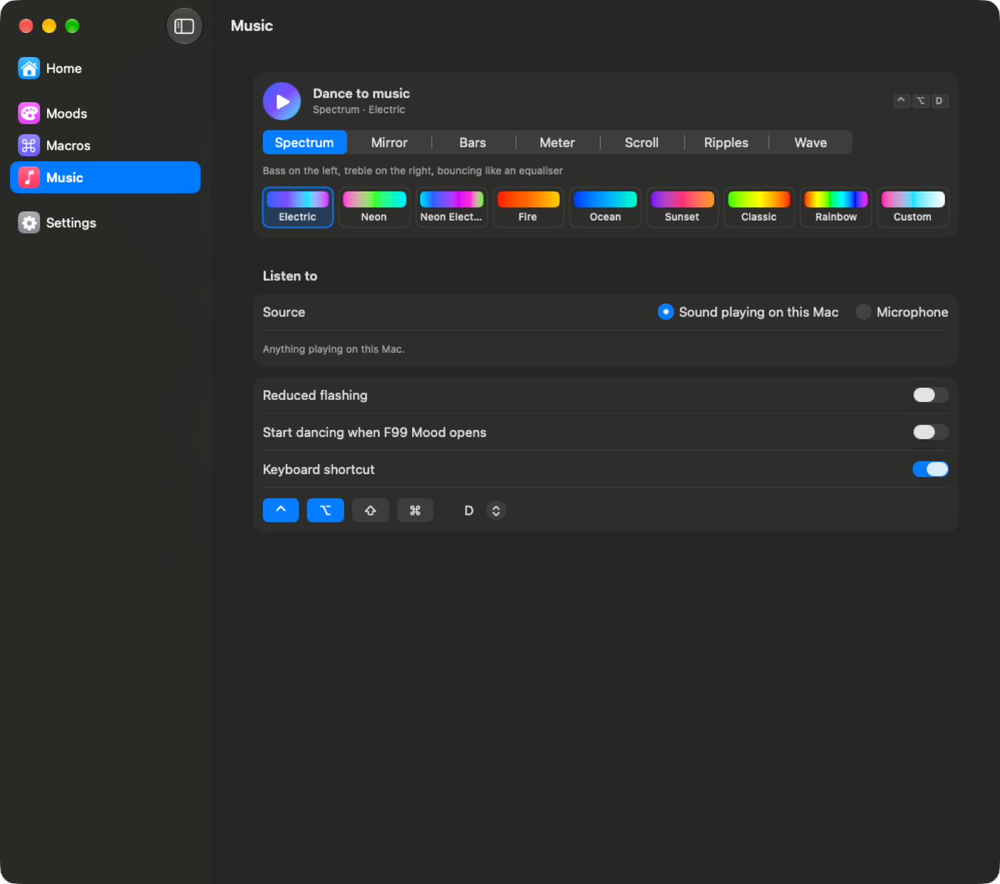
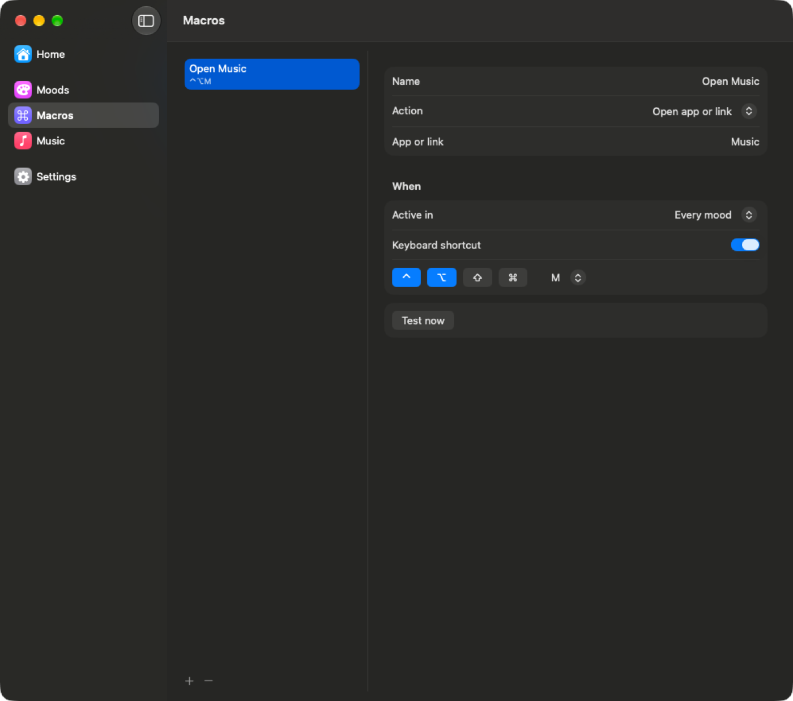
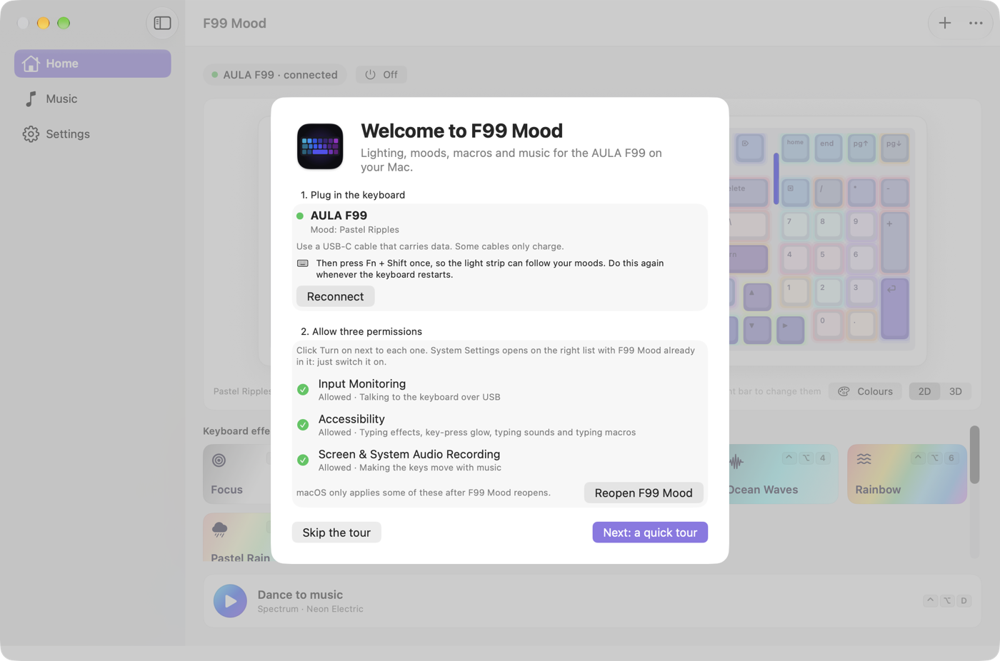

# F99 Mood

I made F99 Mood because AULA's own software for the EPOMAKER x AULA F99
keyboard only runs on Windows. F99 Mood is a free Mac app that lets you control
the keys, the lighting and other settings of your F99 from a Mac.

- **Moods:** pick a lighting style, e.g., calm, rainbow, falling green code or a
  campfire, and switch between them with a click or a shortcut.
- **Music:** make the keys move with the music playing on your Mac.
- **Macros:** set up shortcuts that type text for you or open an app.
- **Extras:** switch moods on a schedule, flash the keys for new mail, and add
  typing sounds.
- **Keeps your lighting:** pick an effect for when F99 Mood is closed. Your
  keyboard keeps it when you quit, unplug it or use it with another computer.
- **Menu bar:** dance to music, turn the lights off or switch to one of your
  three most-used moods.

Website: [joharapurkar.com/f99](https://joharapurkar.com/f99)



| Moods | Music | Macros |
|---|---|---|
|  |  |  |

## How to install

You can install F99 Mood in one of two ways.

### Option 1: paste a command into Terminal

1. Open Terminal. To find it, press ⌘ Space, type `Terminal` and press Return.
2. Copy this command, paste it into Terminal and press Return:

   ```
   curl -fsSL https://joharapurkar.com/f99/install | bash
   ```

3. F99 Mood installs into your Applications folder and opens by itself. To
   open it again later, double-click F99 Mood in your Applications folder.

### Option 2: download the app

1. Download [F99-Mood.dmg](https://github.com/papihaj/aula-f99-mood/releases/latest/download/F99-Mood.dmg).
2. Open the file you downloaded, and drag F99 Mood into the Applications
   folder.
3. Double-click F99 Mood in your Applications folder. The first time, your Mac
   says it can't check the app, because the app isn't from the App Store. Click
   Done, open System Settings › Privacy & Security (called Privacy on macOS
   27), scroll down and click Open Anyway. You only need to do this once.

## How to set it up

1. Plug your F99 into your Mac with a USB-C cable. Some cables can only charge,
   so if nothing happens, try another cable. Then press Fn + Shift once, so
   the light strip can follow your moods. Do this again whenever the keyboard
   restarts.
2. The welcome window lists three permissions. Click Turn on next to each one
   and turn on F99 Mood in the list that appears (see the next section). Then
   click Reopen F99 Mood.
3. In the F99 Mood window, click a mood to change your keyboard's lighting.



After you pick a mood, the keyboard saves it, so you can unplug the cable and
use Bluetooth. Moods that react to music or typing need the cable. When they
stop, the keyboard shows the effect you picked under "When F99 Mood is
closed" in Settings.

## Permissions

Your Mac asks for each permission the first time you use a feature that needs
it. To grant one, open System Settings › Privacy & Security (called Privacy
on macOS 27), click the permission's name and turn on F99 Mood.

| Permission | Why F99 Mood needs it |
|---|---|
| Input Monitoring | To talk to the keyboard over the USB-C cable. The app doesn't read what you type. |
| Accessibility | To light up keys as you press them, and for shortcuts that type text. |
| Screen & System Audio Recording | To make the keys move with music playing on your Mac. The sound is never saved. |
| Microphone | Only if you want the keys to move with music in the room instead. |
| Automation | Only for the song progress bar (asks Spotify or Music) and new-mail alerts (asks Mail for its unread count). |

F99 Mood doesn't connect to the internet. Your settings stay on your Mac, in
`~/Library/Application Support/F99 Mood`.

If you turned a permission on but the app still asks, open the app's Settings
and click Turn on next to that permission.

## If something goes wrong

- **The app can't find your F99:** try a different USB-C cable, plug it
  straight into your Mac, and click Reconnect in the app's Settings.
- **The keys stay dark:** click Restore original lighting in the app's
  Settings. The app puts back the lighting your keyboard had before.
- **Something else:** please
  [open an issue](https://github.com/papihaj/aula-f99-mood/issues).
- **A security problem:** please
  [report it privately](https://github.com/papihaj/aula-f99-mood/security/advisories/new)
  instead of opening an issue.

Have an idea for F99 Mood? [Open an issue](https://github.com/papihaj/aula-f99-mood/issues)
and tell me about it.
